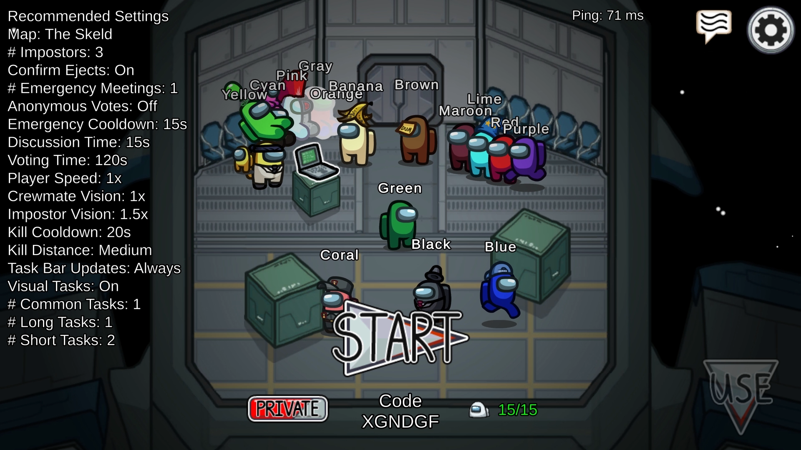
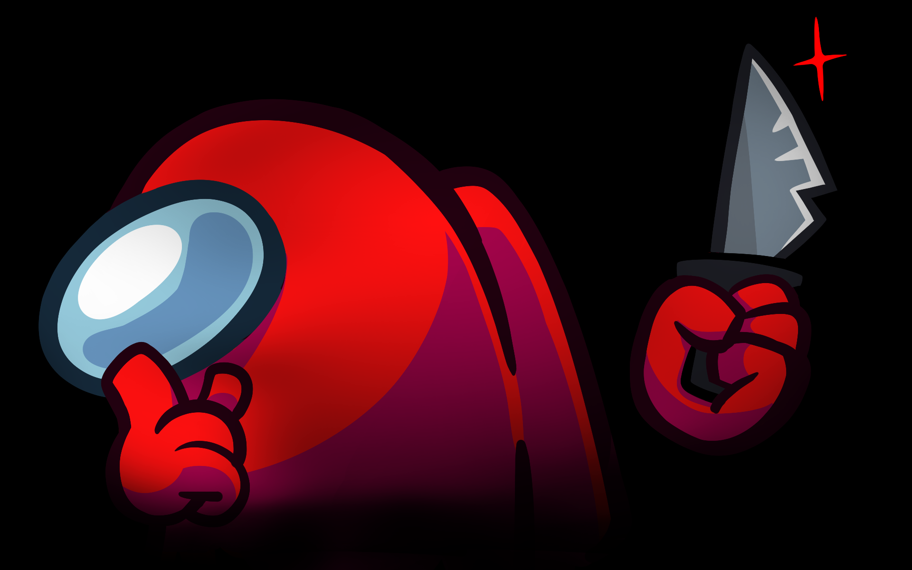
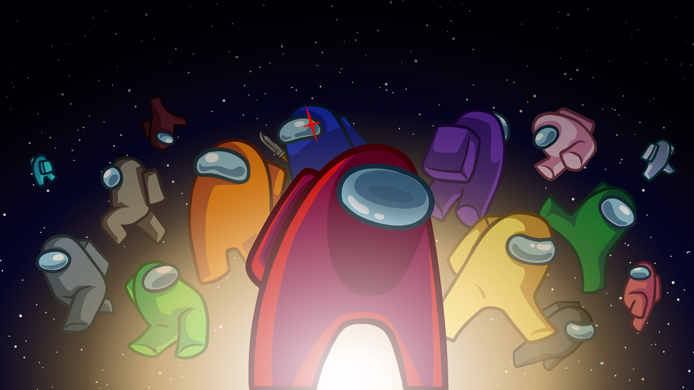
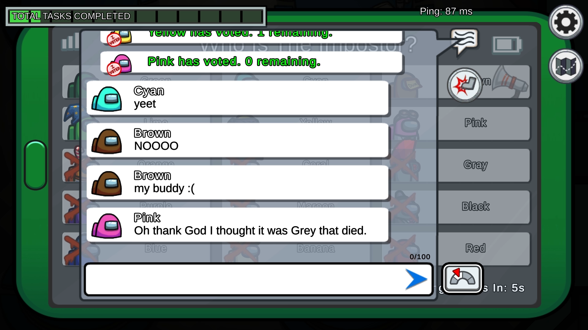
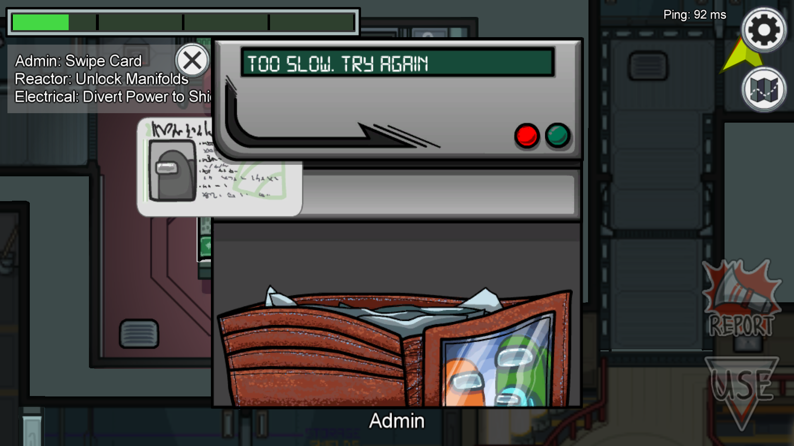
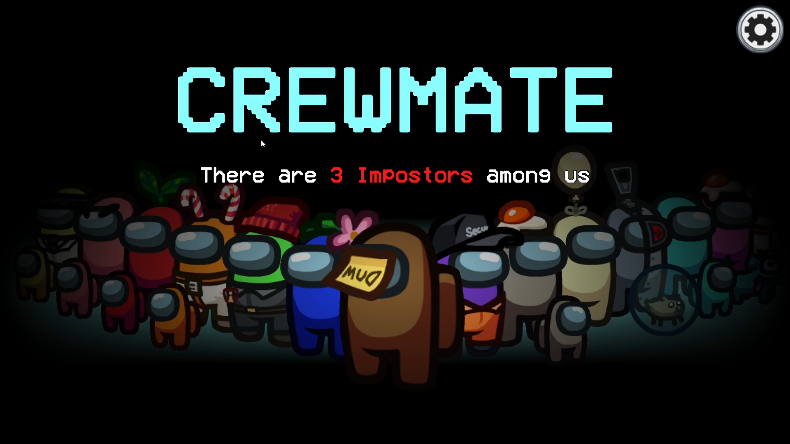
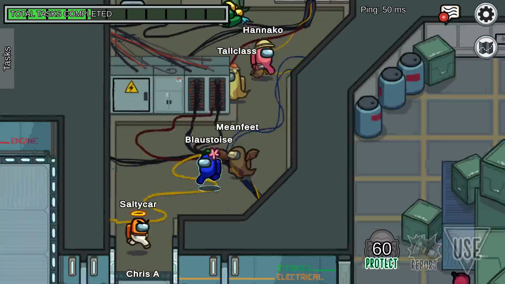
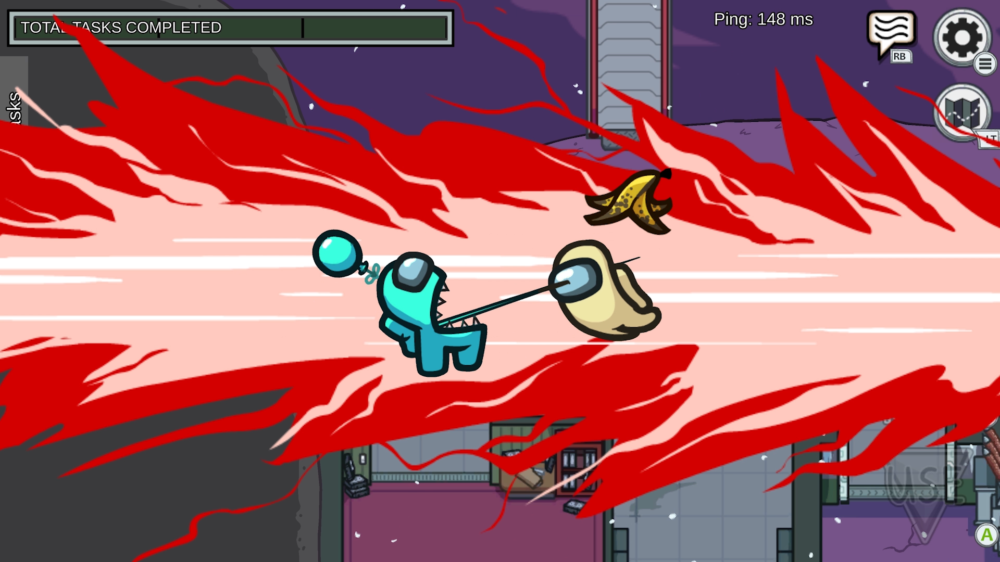

# ASSET CATALOG — MISSION: PROBABILITY
*Official Among Us Visual & Audio Asset Inventory*

Dokumen ini memuat katalog lengkap dan status verifikasi aktual dari seluruh file aset yang tersimpan secara lokal di folder `public/assets/among-us/`.

> [!NOTE]
> **Rekonsiliasi Inventaris**: Pada audit sebelumnya, tercatat referensi parsial (25 item). Setelah dilakukan verifikasi file riil per byte di disk, repositori memiliki **33 file aset resmi** (7 latar belakang, 14 karakter, 5 game UI, 3 ikon vektor SVG, dan 4 aset promosi/branding). Seluruh file 100% utuh dan siap digunakan.

---

## 1. KATALOG LATAR BELAKANG (`backgrounds/`) — 7 File

| Preview | Nama File & Format | Dimensi | Transparansi | Status Verifikasi | Rekomendasi Slide | Catatan Teknis & Penggunaan |
| :---: | :--- | :---: | :---: | :---: | :---: | :--- |
|  | `space-stars-background.jpg` *(PNG Stream)* | 1438x810 | Ya | `FOUND_OFFICIAL` | Slide 01, 07, 08 | Latar belakang kanvas universal luar angkasa bertabur bintang resmi Steam. |
|  | `skeld-dropship-lobby.webp` *(WebP Lossless)* | 1920x1080 | Ya | `FOUND_OFFICIAL` | Slide 02 (Briefing) | Interior pesawat dropship pra-misi. Sangat cocok sebagai ruang briefing misi awal. |
|  | `skeld-cafeteria-meeting-table.jpg` *(JPEG)* | 1920x1080 | Tidak | `FOUND_OFFICIAL` | Slide 03 (Binomial) | Meja meeting Cafeteria The Skeld. Representasi trial biner (Crewmate vs Impostor). |
|  | `skeld-admin-map-room.jpg` *(JPEG)* | 1920x1080 | Tidak | `FOUND_OFFICIAL` | Slide 04 (Poisson) | Ruang monitor navigasi The Skeld. Representasi hitung anomali per interval waktu. |
|  | `skeld-electrical-room.jpg` *(JPEG)* | 1920x1080 | Tidak | `FOUND_OFFICIAL` | Slide 05 (Eksponensial) | Ruang kelistrikan dan breaker panel. Latar belakang waktu tunggu perbaikan / cooldown. |
|  | `skeld-reactor-core-room.jpg` *(JPEG)* | 1920x1080 | Tidak | `FOUND_OFFICIAL` | Slide 06 (Normal) | Ruang inti reaktor dengan manifold. Latar kalibrasi suhu sensor dan kurva Gaussian. |
|  | `space-ejection-sequence.png` *(PNG Full HD)* | 1920x1080 | Ya | `FOUND_OFFICIAL` | Slide 10 (Completed) | Visual ejeksi resmi ke ruang hampa. Resolusi 3.65 MB, dramatis untuk penutup misi. |

---

## 2. KATALOG KARAKTER CREWMATE & IMPOSTOR (`characters/`) — 14 File

| Preview | Nama File & Format | Dimensi | Transparansi | Status Verifikasi | Rekomendasi Slide | Catatan Teknis & Penggunaan |
| :---: | :--- | :---: | :---: | :---: | :---: | :--- |
|  | `crewmate-red-standing.png` *(PNG)* | 150x198 | Ya (Alpha) | `FOUND_OFFICIAL` | Slide 01, 02 | Pose netral Red berdiri tegak. Maskot investigasi. |
|  | `crewmate-red-alibi.png` *(PNG)* | 150x198 | Ya (Alpha) | `FOUND_OFFICIAL` | Slide 07, 09 | Red memegang berkas alibi / data statistik Z-score. |
|  | `crewmate-red-task.png` *(PNG)* | 150x198 | Ya (Alpha) | `FOUND_OFFICIAL` | Slide 03 | Red pura-pura mengerjakan task. Kontras sukses/gagal. |
|  | `crewmate-yellow-tablet.png` *(PNG)* | 150x198 | Ya (Alpha) | `FOUND_OFFICIAL` | Slide 04 | Yellow mencatat jumlah kejadian anomali pada tablet. |
|  | `impostor-purple-kill.png` *(PNG)* | 150x198 | Ya (Alpha) | `FOUND_OFFICIAL` | Slide 03, 09 | Purple Impostor mengintai. Simbol peluang kejadian langka/bahaya. |
|  | `crewmate-purple-wires.png` *(PNG)* | 150x198 | Ya (Alpha) | `FOUND_OFFICIAL` | Slide 05 | Purple memperbaiki kabel. Representasi durasi waktu kontinu $t$. |
|  | `crewmate-green-vent.png` *(PNG)* | 150x198 | Ya (Alpha) | `FOUND_OFFICIAL` | Slide 04, 05 | Green melompat ke ventilasi. Indikator interval perpindahan cepat. |
|  | `crewmate-blue-tablet.png` *(PNG)* | 150x198 | Ya (Alpha) | `FOUND_OFFICIAL` | Slide 06 | Blue memantau data kalibrasi sensor reaktor normal $\mu, \sigma$. |
|  | `crewmate-blue-emergency.png` *(PNG)* | 150x198 | Ya (Alpha) | `FOUND_OFFICIAL` | Slide 09 | Blue panik menekan emergency buzzer. Trigger kuis interaktif. |
|  | `crewmate-blue-sabotage.png` *(PNG)* | 150x198 | Ya (Alpha) | `FOUND_OFFICIAL` | Slide 05 | Blue melakukan sabotase lampu/oksigen. Event laju kegagalan $\lambda$. |
|  | `crewmate-blue-doors.png` *(PNG)* | 150x198 | Ya (Alpha) | `FOUND_OFFICIAL` | Slide 08 | Blue menutup pintu sekat. Pembatas kompartemen distribusi. |
|  | `crewmate-white-voting.png` *(PNG)* | 150x198 | Ya (Alpha) | `FOUND_OFFICIAL` | Slide 09, 10 | White menaruh suara voting. Simbol verifikasi audiens. |
|  | `impostor-profile-hd.webp` *(WebP)* | 1920x1200 | Ya | `FOUND_OFFICIAL` | Slide 01, 09 | Profil resolusi tinggi Impostor resmi. Hero visual yang sangat kuat. |
|  | `crewmates-15-lineup.webp` *(WebP Ultra HD)* | 7778x4375 | Ya | `FOUND_OFFICIAL` | Slide 02, 10 | Banner 8K transparan berisi 15 warna kru lengkap melayang di angkasa. |

---

## 3. KATALOG GAME UI & SCREENSHOT RESMI (`game-ui/`) — 5 File

| Preview | Nama File & Format | Dimensi | Transparansi | Status Verifikasi | Rekomendasi Slide | Catatan Teknis & Penggunaan |
| :---: | :--- | :---: | :---: | :---: | :---: | :--- |
|  | `emergency-meeting-voting-screen.webp` *(WebP)* | 1920x1080 | Ya | `FOUND_OFFICIAL` | Slide 03, 09 | Layar pemungutan suara resmi dengan kotak avatar nama pemain. |
|  | `task-admin-card-swipe.webp` *(WebP)* | 1920x1080 | Ya | `FOUND_OFFICIAL` | Slide 03 | Task gesek kartu Admin. Sangat pas untuk analogi percobaan Bernoulli. |
|  | `role-reveal-shhh-screen.webp` *(WebP)* | 1920x1080 | Ya | `FOUND_OFFICIAL` | Slide 01, 03 | Layar Shhh! dengan siluet merah menaruh jari di visor. |
|  | `guardian-angel-protect.webp` *(WebP)* | 1920x1080 | Ya | `FOUND_OFFICIAL` | Slide 08 | Antarmuka pelindung kru hantu. Analogi probabilitas komplementer. |
|  | `impostor-kill-action.webp` *(WebP)* | 1920x1080 | Ya | `FOUND_OFFICIAL` | Slide 04 | Aksi eliminasi Impostor resmi. Analogi kejadian Poisson diskrit. |

---

## 4. KATALOG IKON VEKTOR (`icons/`) — 3 File

| Preview | Nama File & Format | Dimensi | Transparansi | Status Verifikasi | Rekomendasi Slide | Catatan Teknis & Penggunaan |
| :---: | :--- | :---: | :---: | :---: | :---: | :--- |
|  | `emergency-meeting-megaphone.svg` *(SVG)* | 17x22 Vektor | Ya (Vector) | `FOUND_OFFICIAL` | Header, Slide 09 | Megafon resmi Emergency Meeting Innersloth. Ikon tajam tak terbatas resolusi. |
|  | `impostor-red-star.svg` *(SVG)* | 27x42 Vektor | Ya (Vector) | `FOUND_OFFICIAL` | Slide 03, 04, 05, 06 | Bintang merah runcing penanda bahaya / formula kunci pada HUD. |
|  | `innersloth-download-arrow.svg` *(SVG)* | 18x13 Vektor | Ya (Vector) | Footer, Slide 10 | Ikon unduhan resmi untuk tombol ekspor ringkasan materi PDF. |

---

## 5. KATALOG PROMOSIONAL & BRANDING (`promotional/`) — 4 File

| Preview | Nama File & Format | Dimensi | Transparansi | Status Verifikasi | Rekomendasi Slide | Catatan Teknis & Penggunaan |
| :---: | :--- | :---: | :---: | :---: | :---: | :--- |
|  | `among-us-official-logo.png` *(PNG)* | 948x258 | Ya (Alpha) | `FOUND_OFFICIAL` | Header, Slide 01 | Logo resmi transparan beresolusi tinggi. Elemen sekunder di samping judul. |
|  | `among-us-space-crew-artwork.png` *(PNG)* | 2500x1224 | Tidak | `FOUND_OFFICIAL` | Slide 02, 10 | Key art resmi kru berkumpul di kapal angkasa. Visual perkenalan tim. |
|  | `crewmate-objective-banner.png` *(WebP)* | 600x100 | Ya | `FOUND_OFFICIAL` | Slide 02, 08 | Banner tajam resmi Innersloth: *"Objective: Fill group task bar"*. |
|  | `impostor-objective-banner.png` *(WebP)* | 600x102 | Ya | `FOUND_OFFICIAL` | Slide 03, 07 | Banner tajam resmi Innersloth: *"Objective: Kill off the crew"*. |

---

## 6. INVENTARIS ASET YANG BELUM TERSEDIA (`NOT_FOUND_USER_ACTION_REQUIRED`)

Aset berikut tidak ditemukan dalam bentuk terisolasi di kanal resmi web. Sesuai prinsip proyek, **tidak diganti dengan AI** melainkan diberi penanda placeholder:

1. `[ASSET NEEDED: OFFICIAL AMONG US CYAN CREWMATE PNG]`
   - Lokasi Target: `public/assets/among-us/characters/crewmate-cyan-standing.png`
   - Spesifikasi: PNG Transparan, min. 500x650 px.
2. `[ASSET NEEDED: OFFICIAL EMERGENCY MEETING BUTTON]`
   - Lokasi Target: `public/assets/among-us/game-ui/emergency-button-isolated.png`
   - Spesifikasi: PNG Transparan 512x512 px.
3. `[ASSET NEEDED: OFFICIAL IN-GAME TASKBAR]`
   - Lokasi Target: `public/assets/among-us/game-ui/taskbar-empty.png`
   - Spesifikasi: PNG Transparan 800x60 px.
4. `[ASSET NEEDED: OFFICIAL THE SKELD MINIMAP]`
   - Lokasi Target: `public/assets/among-us/game-ui/skeld-minimap-isolated.png`
   - Spesifikasi: PNG Transparan / SVG 1920x1080 px.
5. `[ASSET NEEDED: OFFICIAL AUDIO SFX]`
   - Lokasi Target: `public/assets/among-us/audio/emergency-siren.mp3`, `task-complete.mp3`, `ui-click.mp3`
   - Spesifikasi: MP3/WAV 44.1kHz.

